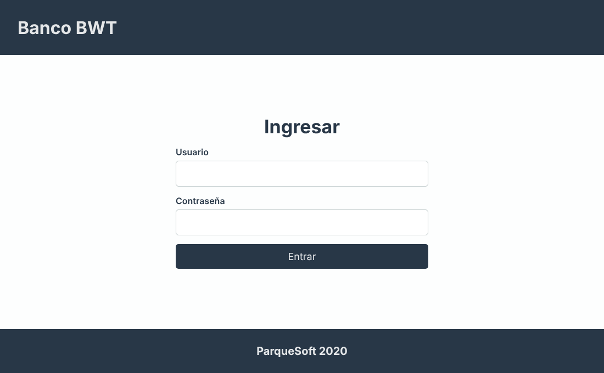
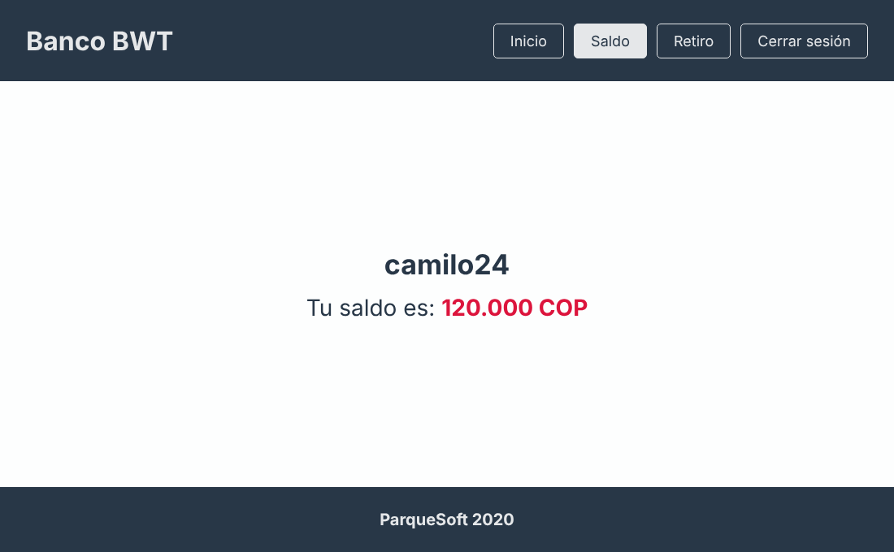
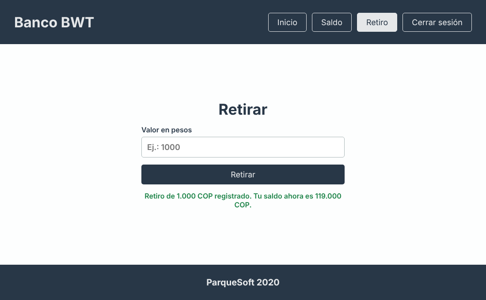
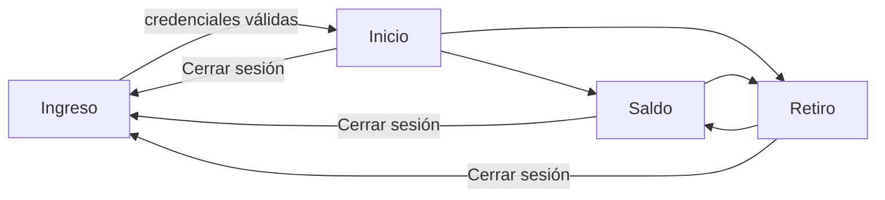
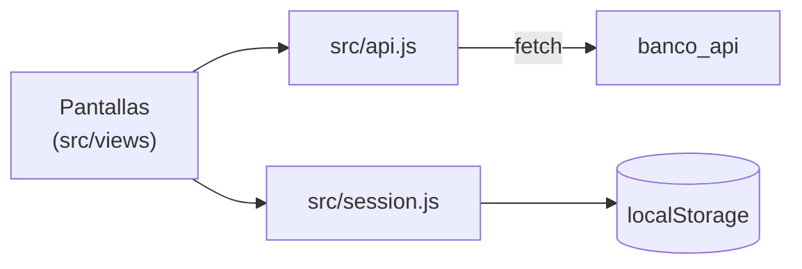

# Banco

Front de un banco de ejemplo hecho con Vue 3 y Vite: ingreso, consulta de saldo y retiros. Consume la API de [banco_api](https://github.com/juandavidalvarez9/banco_api).

| Ingreso | Saldo | Retiro |
|---|---|---|
|  |  |  |

## Cómo funciona



Sin sesión, cualquier ruta lleva al ingreso. La sesión se guarda en el navegador, así que sobrevive a una recarga.



| Archivo | Responsabilidad |
|---|---|
| `src/api.js` | Única salida hacia la API. Convierte los fallos en mensajes legibles |
| `src/session.js` | Quién ha ingresado; guarda y recupera el usuario |
| `src/router.js` | Rutas y protección de las pantallas privadas |
| `src/views/` | Ingreso, inicio, saldo y retiro |

## Cómo ejecutarlo

Requiere Node 22 (22.22 o superior) o Node 24.

1. Levanta la API siguiendo el README de [banco_api](https://github.com/juandavidalvarez9/banco_api). Queda en `http://127.0.0.1:8000`.
2. En este repositorio:

```bash
npm install
npm run dev
```

Abre <http://localhost:5173> e ingresa con `camilo24` / `root`.

Para generar y servir la versión de producción:

```bash
npm run build
npm run preview
```

## Configuración

| Variable | Para qué sirve | Valor por defecto |
|---|---|---|
| `VITE_API_URL` | URL de banco_api | `http://127.0.0.1:8000` |

Copia `.env.example` como `.env.local` para cambiarla. Si sirves el front desde otro origen, agrégalo a `ALLOWED_ORIGINS` en la API.

## Pruebas

```bash
npm test
```

Son 31 pruebas con Vitest sobre la capa de API, la sesión, las pantallas y la navegación.

## Límites

- Es una demostración: la sesión solo recuerda el nombre de usuario en el navegador y la API no emite token, así que no protege nada real.
- Solo hay retiros, porque es lo que ofrece la API.
- `npm audit` reporta 5 avisos moderados en dependencias de desarrollo (`glob` y `minimatch`, traídas por la librería de pruebas). Lo que se compila y se sirve no tiene avisos (`npm audit --omit=dev`).

## Licencia

CC0 1.0 Universal. Ver [LICENSE](LICENSE).
